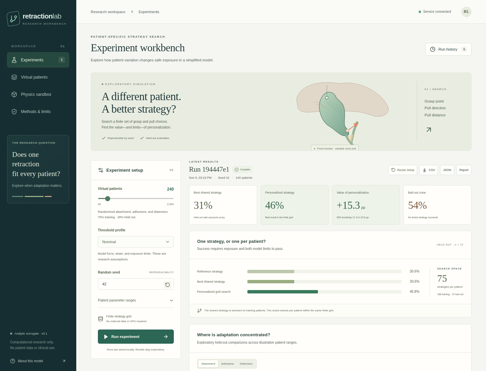

# Retraction Lab

A working computational research workbench for **“Does one retraction fit all?”** Compare a shared gallbladder-retraction strategy with patient-specific grid search, then test whether a one-second force probe predicts who needs adaptation.

**The cohort study engine uses an analytic surrogate.** A separate optional sandbox runs an actual LapGym/SOFA scene; it is not yet the proposed parameterized retraction study. All cohort patients are synthetic. Patient-dependent pull directions are imposed by the model equations, so gains demonstrate pipeline behavior and cannot validate the original physical or clinical hypothesis. No reinforcement-learning agent is included.



## Quick start

Requires **Python 3.12** and **Node.js 22 or 24**, with npm. No GPU, database server, external API, or secret is needed.

```bash
./scripts/setup.sh
./scripts/start.sh
```

The single-process server listens on port **8000** and serves the built dashboard plus the API. `GET /api/health` must return `status: ok`. Open the service in your local browser when running locally. API reference is at `/docs`.

1. Choose cohort size, seed, and assumed threshold profile.
2. Run the experiment and inspect held-out success, personalization gain, and grid bail-out cases.
3. Compare the reference, training-selected shared strategy, and personalized grid strategy for each patient.
4. Inspect the force probe, calibration, and threshold sensitivity. Export complete JSON or patient-level CSV.

Run history persists in `.data/` when using the startup script. Startup processes must be restarted after restoring a cloud snapshot.

## What works

- Deterministic virtual cohorts varying attachment length, adhesion count/stiffness, and distension.
- An exhaustive **75-strategy grid**: 3 grasp points × 5 pull angles × 5 pull distances.
- Geometric exposure proxy with simultaneous modeled force and strain constraints.
- Fixed reference, best shared strategy selected on training patients, and per-patient grid optimum.
- Held-out paired personalization benefit with a seeded bootstrap interval.
- Fixed one-second force probe, training-only logistic regression, held-out AUROC/Brier score/calibration, and a separate grid-bail-out classifier.
- Three assumed threshold profiles, saved runs, background jobs, JSON/CSV exports, and an interactive dashboard.
- Reproducible command-line experiments and multi-seed study bundles.

## Development and tests

```bash
./scripts/check.sh
```

This runs the backend tests and the TypeScript/production frontend build. For hot reloading, use two terminals:

```bash
# Terminal 1
cd backend
../.venv/bin/python -m uvicorn retraction.main:app --reload --host 127.0.0.1 --port 8000
# Terminal 2, from the repository root
npm --prefix frontend run dev
```

Vite proxies `/api` to port 8000. Use **one API server process**: job recovery assumes a single coordinator, so multiple workers or replicas are unsupported. Interrupted jobs are marked failed after restart rather than silently completed.

`RETRACTION_VENV_DIR` overrides the virtual environment path for the scripts. `RETRACTION_DATA_DIR` overrides local run storage. `HOST` and `PORT` override startup binding. The default is a local research app with no authentication; an authenticated hosting layer is required for shared deployment.

The direct backend dependencies live in `backend/requirements.txt`; setup installs the tested full resolution in `backend/requirements.lock`. The frontend uses `npm ci` with its lockfile.

## Headless experiments

Run from `backend/`:

```bash
../.venv/bin/python -m retraction --patients 240 --seed 42 --profile nominal --output ../.data/example.json
../.venv/bin/python -m retraction.study --seeds 42 43 44 --patients 240 --output ../.data/study-001
```

The study runner evaluates all three threshold profiles for each seed. It writes its full protocol and source fingerprints **before** running, then individual JSON results, `summary.csv`, `report.md`, and a completion marker. Outputs refuse to overwrite previous experiments. A bundle without `complete.json` is incomplete. Protocol capture is local and exploratory; it does not establish external preregistration.

Use `--config path/to/config.json` to set patient distributions; API `/api/presets` returns defaults. Custom force/strain/exposure limits are supported for individual experiments. Named threshold profiles are required for batch sensitivity studies.

## Interpretation and next steps

“Success” means a **model exposure proxy** meets assumed limits, not clinical CVS achievement. “Bail-out” means no strategy in the finite grid succeeds, not that every surgical option would fail. The probe is quasi-static and noise-free, with any modeled probe-limit violations reported. Bootstrapping quantifies synthetic patient sampling, not uncertainty in tissue mechanics or model design.

A separate optional Physics sandbox now runs a real LapGym/SOFA gallbladder scene, including rendered frames, scripted grasping, and bounded instrument motion. It does not yet implement this study’s cohort parameters, CVS proxy, or force thresholds. The next research milestones are validated tissue mechanics, anatomical/camera landmark visibility, mesh convergence, expert-reviewed thresholds, probe noise/stop rules, and independently trained RL agents. See [the research plan](docs/research-plan.md) and [model reference](docs/model.md).

## Browser validation

After starting the built app, optionally install `backend/requirements-browser.txt` into `.venv`, install a Chromium browser with `python -m playwright install --with-deps chromium`, and run:

```bash
.venv/bin/python scripts/browser_smoke.py
```

The script uses system Chromium if available, otherwise Playwright-managed Chromium. `--chromium /path/to/browser` overrides it. It creates a real 40-patient run, verifies downloads and saved history, checks mobile layout, and tests explicitly intercepted offline/error states. CI runs this check and preserves screenshots and a JSON report.

## Optional real-physics sandbox

On Linux x86_64 with `uv`, EGL/OpenGL, and standard download tools:

```bash
bash scripts/setup-sofa.sh
```

The optional installer creates an isolated Python 3.10 runtime with the pinned upstream source and a checksum-verified SOFA 24.06 distribution. In this cloud workspace it is already installed under `/workspace/.sofa-runtime`; the main application continues to use Python 3.12. Open **Physics sandbox** in the app to run an actual scene and inspect initial/final rendered frames, gripper pose, grasp state, and per-step mesh telemetry. The API isolates each scene in its own bounded subprocess, preserves history separately, and stops timed-out process groups.

The upstream mesh files contain incomplete/inconsistent lower-dimensional connectivity. A documented wrapper derives full face/edge connectivity from their unchanged tetrahedra. Independent connectivity checks and real grasp/pull runs pass with zero SOFA errors; nonfatal warnings and `Undefined` component states remain visible. **This repairs an identified adjacency issue, not tissue-model validation.** Raw internal-force sums are not calibrated tool forces in newtons.

Read [the setup and integration reference](docs/sofa-integration.md) and [the independent mesh diagnosis](docs/physics-diagnostics.md) for provenance, limitations, and repeatable audit commands. The optional browser test `python scripts/physics_browser_smoke.py --exercise-grasp` runs real neutral and scripted-grasp scenes; it is separate from the lightweight core CI suite. Dependencies are about 2 GB and are retained outside the repository; they are not committed to GitHub.

For an automated accessibility check against the running app, install the optional browser requirements and run `npm --prefix frontend run audit:a11y` (Python Playwright must be available to that command). It uses locally pinned axe-core and reports violations separately from incomplete/manual checks. See [the validation record](docs/validation.md) for tested capabilities and their limits.
