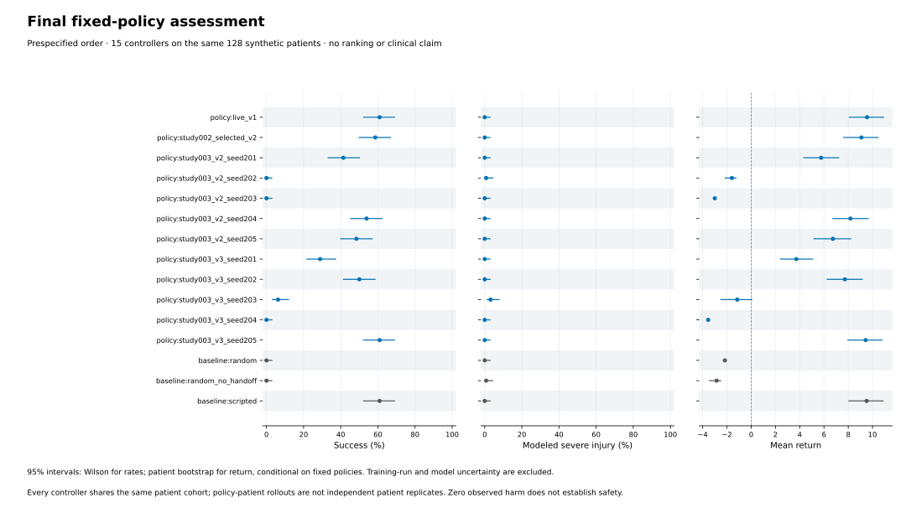

# Final fixed-policy evaluation

15 fixed controllers were assessed on the same **128 synthetic patients**, giving 1920 recorded rollouts. These are not 1920 independent patients. Rows follow the prespecified design; no ranking or replacement-policy selection is performed.

The individual-policy intervals condition on these fixed checkpoints and exclude training-run and tissue-model uncertainty. Binary intervals are Wilson 95% bounds. Return intervals use patient-only bootstrap resampling from recorded outcomes with the frozen evaluation RNG. All pairwise comparisons are unadjusted for multiplicity; no familywise superiority claim is supported.

| Prespecified controller | n | Success [95% CI] | Severe injury [95% CI] | Mean return [95% CI] | Mean peak injury |
| --- | ---: | --- | --- | --- | ---: |
| `policy:live_v1` | 128 | 60.9% [52.3, 69.0] | 0.0% [0.0, 2.9] | 9.552 [8.092, 10.918] | 0.00006 |
| `policy:study002_selected_v2` | 128 | 58.6% [49.9, 66.8] | 0.0% [0.0, 2.9] | 9.086 [7.616, 10.444] | 0.00224 |
| `policy:study003_v2_seed201` | 128 | 41.4% [33.2, 50.1] | 0.0% [0.0, 2.9] | 5.766 [4.328, 7.220] | 0.01155 |
| `policy:study003_v2_seed202` | 128 | 0.0% [0.0, 2.9] | 0.8% [0.1, 4.3] | -1.589 [-2.144, -1.253] | 0.01307 |
| `policy:study003_v2_seed203` | 128 | 0.0% [0.0, 2.9] | 0.0% [0.0, 2.9] | -3.000 [-3.000, -3.000] | 0.00000 |
| `policy:study003_v2_seed204` | 128 | 53.9% [45.3, 62.3] | 0.0% [0.0, 2.9] | 8.181 [6.724, 9.642] | 0.00187 |
| `policy:study003_v2_seed205` | 128 | 48.4% [40.0, 57.0] | 0.0% [0.0, 2.9] | 6.739 [5.179, 8.203] | 0.01243 |
| `policy:study003_v3_seed201` | 128 | 28.9% [21.8, 37.3] | 0.0% [0.0, 2.9] | 3.726 [2.423, 5.064] | 0.00997 |
| `policy:study003_v3_seed202` | 128 | 50.0% [41.5, 58.5] | 0.0% [0.0, 2.9] | 7.723 [6.258, 9.149] | 0.00086 |
| `policy:study003_v3_seed203` | 128 | 6.2% [3.2, 11.8] | 3.1% [1.2, 7.8] | -1.151 [-2.487, 0.062] | 0.02977 |
| `policy:study003_v3_seed204` | 128 | 0.0% [0.0, 2.9] | 0.0% [0.0, 2.9] | -3.547 [-3.556, -3.537] | 0.00000 |
| `policy:study003_v3_seed205` | 128 | 60.9% [52.3, 69.0] | 0.0% [0.0, 2.9] | 9.435 [7.962, 10.785] | 0.00234 |
| `baseline:random` | 128 | 0.0% [0.0, 2.9] | 0.0% [0.0, 2.9] | -2.168 [-2.212, -2.127] | 0.00001 |
| `baseline:random_no_handoff` | 128 | 0.0% [0.0, 2.9] | 0.8% [0.1, 4.3] | -2.846 [-3.436, -2.515] | 0.00617 |
| `baseline:scripted` | 128 | 60.9% [52.3, 69.0] | 0.0% [0.0, 2.9] | 9.518 [8.051, 10.878] | 0.00009 |

Zero observed severe injury does not establish zero risk. Low injury with failure or handoff is not successful procedure control. These illustrative mechanics and harm thresholds have no clinical validation.

The validation-selected study-003 V3 example, if referenced elsewhere, is an alias of one included V3 checkpoint. It is not an extra controller or independent replicate.

[All controller metrics](validation/rl-final-001-controllers.csv) · [All unadjusted paired return contrasts](validation/rl-final-001-paired-return-contrasts.csv) · [Report provenance](validation/rl-final-001-report-provenance.json)

The pre-outcome policy-freeze manifest is verified (`5e93f6c6cdd043a63efb8f902ffca8ae62a557d7175dde527bce5abb7fef7309`). Prespecified validation aliases: `study003_global` → `study003_v2_seed204`; `study003_v3` → `study003_v3_seed205`. No alias adds a result row.

## Prespecified crossed V3 minus V2 supplement

The five paired training seeds are crossed with the same 128 patients. A replicate resamples five seed rows and **one common patient-index vector**, then averages their Cartesian product; all three outcomes share these indices. The 640 policy-patient outcomes per arm are correlated repeated measurements, not 640 independent patients.

These descriptive 95% percentile intervals include variation across the five observed training seeds, may be unstable, exclude tissue/model error, and are unadjusted across three outcomes and other comparisons. A zero-event difference interval does not establish zero absolute risk or equivalence; inspect individual-policy Wilson bounds.

| Fixed-policy set | Policies | Shared patients | Mean success (range) | Mean severe injury (range) | Mean return (range) |
| --- | ---: | ---: | --- | --- | --- |
| `study003_v2` | 5 | 128 | 28.750% (0.000–53.906) | 0.156% (0.000–0.781) | 3.219 (-3.000–8.181) |
| `study003_v3` | 5 | 128 | 29.219% (0.000–60.938) | 0.625% (0.000–3.125) | 3.237 (-3.547–9.435) |

| Outcome (V3 − V2) | Mean difference | Crossed 95% interval |
| --- | ---: | --- |
| return | 0.018 return units | [-6.601, 5.626] |
| success | 0.469 percentage points | [-31.094, 29.066] |
| severe_harm | 0.469 percentage points | [-0.625, 2.344] |

[Five paired-seed descriptors](validation/rl-final-001-study003-paired-seeds.csv) · [Fixed-policy arm descriptors](validation/rl-final-001-study003-fixed-arm-descriptors.csv) · [Crossed contrast values](validation/rl-final-001-study003-crossed-contrasts.csv)

## Integrity and interpretation

The generator verifies completion and raw file hashes, copied policy/checkpoint hashes, declared counts, patient alignment, aggregate outcomes, Wilson bounds, rollout-log consistency, and the complete paired-return contrast set. It imports no simulator, trainer, policy loader, or evaluator. The output directory is new and input records are unchanged.

Physics fingerprint: `99bcc146975fff6221c65ee927d4bc38373a18069e56ce8cd45bf7a75c984898`. Protocol SHA-256: `91b79c60b941b780074ecfa3478f15e2e674910110541d14e466ddc5162230f6`.

[PNG figure](assets/rl-final-001-fixed-policies.png)

## Frozen records and future work

The [complete final archive](../research-artifacts/rl-final-evaluation-001-full.zip) and [checksum](../research-artifacts/rl-final-evaluation-001-full.zip.sha256) preserve all 1,920 raw episode records, the twelve exact input policies, protocol, execution log, completion marker, sources, exclusion evidence, explicit authorization, independent audit, and original verified report. The archive is separate from the Windows installer.

The [prespecified design](../examples/final-evaluation-001-design.json), [policy hash freeze](../examples/final-evaluation-001-policy-freeze.json), and [crossed-analysis plan](../examples/final-evaluation-001-crossed-analysis.json) were recorded before final outcomes. An independent saved-data audit reproduced all 105 paired-return intervals and the crossed-analysis results without another rollout.

The existing bundled V1 reference is unchanged. In this fixed test it and the continuous scripted baseline each succeeded on 78/128 cases; neither result establishes an autonomous surgical capability. The five paired V2/V3 runs show no demonstrated improvement, and harmful and zero-success policies remain reported. The reserved cohort is now consumed: subsequent tuning must not reuse it as an untouched test.
