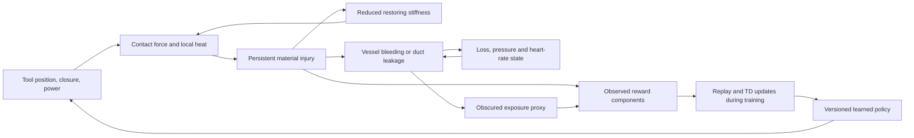

# Stateful tissue-response and reinforcement-learning environment

`retraction.environment.TissueRetractionEnv` implements a complete sequential
agent → action → tissue response → observation/reward loop. Tools move, acquire
contact, deform tissue and can cause persistent injury. Injury changes subsequent
mechanics; vessel or duct injury can produce ongoing simulated blood loss or
bile leakage. These are governed surrogate states, not prerecorded animations or
independent cosmetic warning flags.

This is an **illustrative analytic model for software experimentation**. It is
not a validated patient, a clinical risk model, SOFA/FEM, a prediction of surgical
outcomes, or a substitute for supervised surgical education. None of the numeric
injury thresholds, material constants, temperatures, flow rates or vital-sign
responses below has been clinically calibrated. The portable environment is
separate from the optional upstream SOFA scene and the original static cohort
strategy-sweep engine.

## Run the agent–environment loop

From the repository root, with backend dependencies installed:

```bash
PYTHONPATH=backend .venv/bin/python - <<'PY'
from retraction.environment import TissueRetractionEnv

env = TissueRetractionEnv({"max_steps": 200})
observation, info = env.reset(seed=2)
while True:
    action = env.scripted_action(observation)  # public-observation feedback baseline
    observation, reward, terminated, truncated, info = env.step(action)
    if terminated or truncated:
        print(info["termination_reason"], info["cumulative_reward"])
        break
env.close()
PY
```

On Windows PowerShell, set `$env:PYTHONPATH="backend"` and use
`.venv\Scripts\python.exe`; the Python API is otherwise identical. SOFA, Linux,
GPU support and a display are not required.

`reset(seed=..., options={"patient": {...}})` optionally accepts exactly four
patient settings: `attachment_length_mm`, `adhesion_count`,
`adhesion_stiffness_n_per_mm` and `distension`. Otherwise a seeded patient is
sampled. `randomize_anatomy=False` selects a fixed illustrative reference patient.
Replay the same configuration, seed, optional patient settings and action list to
reproduce the entire episode. Reset clears geometry, temperature, accumulated
injury, losses, tools and reward history; an ordinary action never heals damage.

`step()` returns the standard Gymnasium five-tuple. `observation_space` is a
239-element finite `float32` Box and `action_space` is a seven-element `float32`
Box with bounds −1 to +1. `env.describe()`, `ACTION_NAMES` and
`OBSERVATION_NAMES` make feature order, bounds, configuration limits, reward
weights and assumptions inspectable. Consumers should use the names rather than
hard-coded feature indices. Full nodal positions, material injury, temperature,
thermal dose and coagulation are observable, as are patient/configuration
parameters, contact, losses, time and exposure history. This deliberately gives
RL more information than a real surgical system observes. The full simulator
observation supports the Markov state transition; a camera-only policy would be
a different, partially observed task.

## Version and source compatibility

The current environment version is `tissue-retraction-1.1`. Early development
runs used `1.0` while the implementation was still changing, so the version text
alone is not sufficient evidence of matching dynamics. `PHYSICS_FINGERPRINT`
and `env.describe()["physics_fingerprint"]` identify the exact source bytes of
`environment.py` and `tissue.py`; each step/reset info includes the same value.

The hash is captured once when the module is imported. A running training job
or episode therefore retains its implementation identity even if source files
later change on disk. Its `sha256-labeled-source-v1` algorithm hashes the fixed
prefix `retraction-physics-source-v1` followed by a zero byte, then each relative
source label plus zero byte, its raw contents, and a final zero byte. Machine
paths are excluded. Source files must preserve LF line endings across platforms.

A packaged application must include both original source files beside its
`retraction` modules; missing source produces an explicit model-setup error,
never a fabricated fingerprint. The exact-byte identifier does not by itself
capture dependency versions, CPU floating-point differences or clinical
validity; the dependency lock and run metadata remain part of reproducibility.

The compatibility contract for policies and saved interactive episodes requires
both environment version and physics fingerprint to match. Old development
sessions remain useful records to inspect/export but must not be advanced under
a changed model. Such a mismatch requires a new episode or policy training run,
not relabeling the existing record with the new identity. The source fingerprint
is separate from the scripted controller's reported version, although a change
to that controller's source also changes the exact file fingerprint.

## Tools and what the model does in response

Coordinates are millimeters in an illustrative 2D plane: x points right and y
points up. The workspace is x ∈ [−30,30], y ∈ [−30,40]. There is no depth or
real contact geometry. The visual client can draw a 3D representation of this
state, but the underlying mechanics remain planar.

| Action index | Tool command | Modeled response |
| --- | --- | --- |
| 0, 1 | Grasper x/y velocity | Moves at up to 10 mm/s. Once gripping, a spring contact transfers traction to the contacted node. |
| 2 | Grasper jaw command | Positive values set closure; zero holds the current closure; values below −0.2 release. Closure ≥0.25 can acquire the nearest intact node within 3 mm. Closure above 0.75 accumulates crush injury. |
| 3, 4 | Cautery x/y velocity | Moves a separate tool at up to 10 mm/s through the same modeled plane. |
| 5 | Cautery power | Positive values deliver a local Gaussian heat source for this interval; zero or negative values turn it off. Heat outside a 7.2-mm neighborhood is zero. |
| 6 | Handoff decision | Values above 0.5 terminate the episode as a handoff. This neither heals the current state nor simulates a successful rescue. |

The model contains 23 material sites: 16 in an oval gallbladder surrogate,
two artery sites, two cystic-duct sites and three common-bile-duct sites.
The grasper starts at [6,3], near the lower-right gallbladder marker; cautery
starts at [−16,−14]. The arterial sites are [−4,−10] and [−2,−16], cystic duct
[2,−8] and [4,−14], and common duct [8,−12], [8,−20] and [8,−28]. These locations
are schematic, not an anatomical reconstruction. Liver/fundus support is a
restoring spring rather than a third controlled tool. Cutting/removing tissue,
suturing, clips, irrigation and suction are not implemented.

Structured `info["state"]` includes both tool poses and contacts; tissue nodes,
edges, material injury, temperature and deformation; exposure; simulated losses
and vital signs; current limits; and termination reason. `info["events"]` reports
contact acquisition/release, injury threshold crossings, bleeding/leak onset,
contact failure and episode termination. A visualizer can derive color changes,
local burns, structural failure, fluid indicators and vital-sign traces from
those actual state variables.

## Inspectable equations and persistent memory

The implementation is in [`tissue.py`](../backend/retraction/tissue.py) and
[`environment.py`](../backend/retraction/environment.py). All constants are
explicit. They represent testable implementation assumptions, not fitted medical
parameters.

For node i, let mechanical injury be mᵢ, accumulated heat dose qᵢ and temperature
Tᵢ. Thermal injury is hᵢ = 1 − exp(−qᵢ/0.8), and combined injury is
Dᵢ = 1 − (1−mᵢ)(1−hᵢ). Both mᵢ and qᵢ are nondecreasing, so injury is irreversible
within an episode.

The restoring stiffness is kᵢ = kᵢ,₀(1−0.9Dᵢ). Base gallbladder stiffness is
1.6 × distension / attachment_length. Left-sided nodes also receive a restoring
term from adhesion count × adhesion stiffness; the fundus support has a larger
restoring stiffness. Same-material neighboring nodes are connected by
length-dependent springs whose stiffness also drops with injury. Nodal forces
combine restoring springs, neighboring springs and grasper contact, and the
positions advance with an overdamped update in five fixed substeps. Contact
coupling is 1.1 × jaw_closure × (1−0.8Dᵢ), so damaged tissue also transmits less
traction. Injury therefore affects future positions and force readings.

Strain is the larger of local tensile edge extension and nodal displacement
normalized by attachment length. During each interval Δt, mechanical injury
increases with 0.45Δt × max(strain/strain_limit−1,0)². At the contacted node,
force overload adds 0.25Δt × max(force/force_limit−1,0)² and excessive jaw closure
adds 0.22Δt × [max(closure−0.75,0)/0.25]². Injury is capped at one. Contact is lost
at combined injury 0.9, representing structural failure in this toy material.
The 20-N contact-force ceiling and workspace clamps are numerical saturation
bounds, **not a modeled surgical safety controller**.

Cautery heat uses a spatial Gaussian of width 2.4 mm and a maximum source rate
of 160 degree-Celsius per second. Temperature also relaxes toward 37°C with a
3-second time constant. Dose increases by Δt × max(T−43,0)/100. Temperature is
bounded at 180°C. This dose is a deliberately simple degree-second surrogate;
it is **not** CEM43, an Arrhenius burn integral or an empirically validated
thermal injury law. Cooling does not undo the stored dose or resulting stiffness
loss.

Arterial injury above 0.08 drives bleeding. A separate, bounded coagulation state
can accumulate during powered heating at 50–70°C; hotter tissue above 85°C can
lose that sealing state. This produces a simplified competing effect of
coagulation and heat injury, not a clinical cautery setting recommendation.
Bleeding rate is 55 × sum[max(D−0.08,0) × (1−coagulation)] times a pressure
factor. Accumulated blood loss cannot exceed the model's 5,000-ml reservoir.
Duct injury above 0.08 drives an ongoing bile-leak state with larger weighting
for common-duct injury. Mechanical or thermal damage can drive either effect.

Mean arterial pressure is clipped from
90 × (1−2.5 × blood_loss/5000), and heart rate from
72 + 180 × blood_loss/5000. Lower pressure feeds back into the next bleeding
rate. These are transparent toy volume-feedback equations, **not human
hemodynamics**. They omit compensation timing, anesthesia, fluid replacement,
coagulation biology, infection and systemic inflammatory response.

Exposure is lower-right marker displacement divided by a distension-dependent
reference opening, minus accumulated blood/bile obscuration, bounded to [0,1].
This is a synthetic projected-view proxy; the environment does not verify the
clinical critical view of safety or identify actual duct anatomy from images.

## Reward and episode boundaries

Per-step rewards are returned as separate `info["reward_components"]` values:

| Component | Rule |
| --- | --- |
| Exposure progress | +4 times a new record-high exposure increment, only while force/strain and injury acceptance conditions hold. |
| New material injury | −12 times summed new nodal injury. |
| New critical-structure injury | An additional −40 times new artery/duct injury. |
| Blood/bile loss | −0.005 per newly lost ml of blood; −0.05 per newly leaked ml of bile. |
| Force excess | −0.1Δt × max(force/force_limit−1,0). |
| Time | −0.01 each action. |
| Successful hold | +15 once. |
| Severe injury or blood-loss stop | −20 once. |
| Handoff | −2 once, without a success label. |
| Horizon exhausted | −1 once; Gymnasium `truncated=True`. |

Record-high progress prevents repeated opening/closing from accumulating the
same reward. Damage cannot be reset or healed with a tool action. Opening the
marker through unacceptable injury earns no progress credit, and a damaged
state cannot meet the success gate. These protections reduce specific reward
exploits; they do not prove the reward captures surgical quality or is immune to
all policy exploits.

Success requires the target exposure for the configured consecutive intervals,
maximum injury below 0.15, artery/duct injury below 0.08, and force and strain
within the selected modeling limits, cautery switched off and all tissue at or
below 43°C. The temperature condition prevents collecting a success bonus before
pending heat can produce delayed injury. Default target is 0.60 for five intervals.
Default termination occurs at maximum injury 0.60, critical injury 0.35,
600 ml modeled blood loss, a handoff or success; the default horizon is 200
steps at 0.1 seconds. These numbers are illustrative. Ordinary injury/handoff/
success stops return `terminated=True`; time exhaustion returns
`truncated=True`. Every further `step()` call after either stop is rejected
until reset, preventing repeated terminal bonuses. All-zero actions do not
accidentally activate cautery or close an initially open grasper, although zero
jaw command continues a previously established closure.

## What has been checked

The saved scripted example with seed 2 reaches modeled success. The transparent
`feedback-strain-guard-1.1` scripted controller closes at 0.55, then uses a
proportional exposure error to pull right (maximum command 0.30). It relaxes
slightly when the observed maximum strain or contact force exceeds 95% of the
selected modeling limit. All decisions use only the supplied public observation;
it does not inspect hidden environment state or an oracle.

These controller gains were **engineering-tuned on development seeds 0–19**.
That development check reached 15/20 modeled successes, with five timeouts,
mean final maximum injury about 0.000081 and maximum about 0.000843. These are
engineering diagnostics, **not an untouched final benchmark or evidence of
clinical safety**. The controller version and tuning provenance are included in
`env.describe()` separately from the unchanged physics/environment version.
The baseline can still time out or accumulate injury on other patients; it is
not an oracle or a claim of safe autonomous surgery. A learned policy must be evaluated
on separate seeds and compared with baseline outcomes, injury, losses and
handoff rates, not only total reward.

Tests exercise resting equilibrium, contact proximity, irreversible crush and
heat injury, cooling without healing, injury-dependent subsequent force and
geometry, traction overload, vessel bleeding with vital-sign response, duct
leakage with view obscuration, action/reset replay, reward decomposition,
record-high reward accounting, terminal-step rejection, and success versus
handoff/failure/truncation. Gymnasium's environment checker passes. Additional
random-action stress checks exercised 1,500 valid transitions across the allowed
timestep range without nonfinite or out-of-bounds observations.

Passing these software checks establishes the implemented feedback loop and its
invariants. It does not validate the equations against real tissue, evaluate
clinical safety or support the proposal's scientific conclusions. Material/heat
calibration, verified tissue failure laws, anatomical meshes, contact-depth and
camera models, force-unit validation, and expert-reviewed experimental criteria
remain necessary before stronger interpretations.

## Material-model choice

This prototype uses monotonic loss of load-bearing stiffness for both mechanical and thermal injury. That is an explicit modeling choice: real thermal tissue response can include contraction and stiffening, and cannot be inferred from these illustrative damage variables. The portable model does not solve viscoelasticity, fluid flow, inflammation, thermal diffusion, or biological healing. New clinical or constitutive conclusions require an independently validated replacement model.

The legacy cohort strategy-search engine and this sequential RL environment have different mechanics and task definitions. Their success rates cannot be combined to claim that an agent recovered the legacy grid oracle’s personalization benefit. Such a comparison requires a matched simulator, cohort, action space, limits, and exposure definition.

## Causal feedback loop and when learning occurs



A manual episode records exactly the transitions and rewards produced by tool
use. The current trainer creates new seeded episodes and optional scripted
training demonstrations; it does not silently ingest the user's manual records.
During **Run policy**, checkpoint weights are frozen: the agent observes the
state and chooses actions, while harm changes the simulated body and subsequent
observations/rewards. During **Train policy**, those observed rewards enter the
replay buffer and actual temporal-difference updates. Retraining produces a new
inspectable checkpoint rather than modifying a previously recorded policy.

The reward trace therefore represents real environment feedback, but a harmful
manual intervention is not itself evidence that a deployed policy has already
learned to avoid it. The separate training/evaluation records establish what
learning occurred and whether it helped on other synthetic patients.
