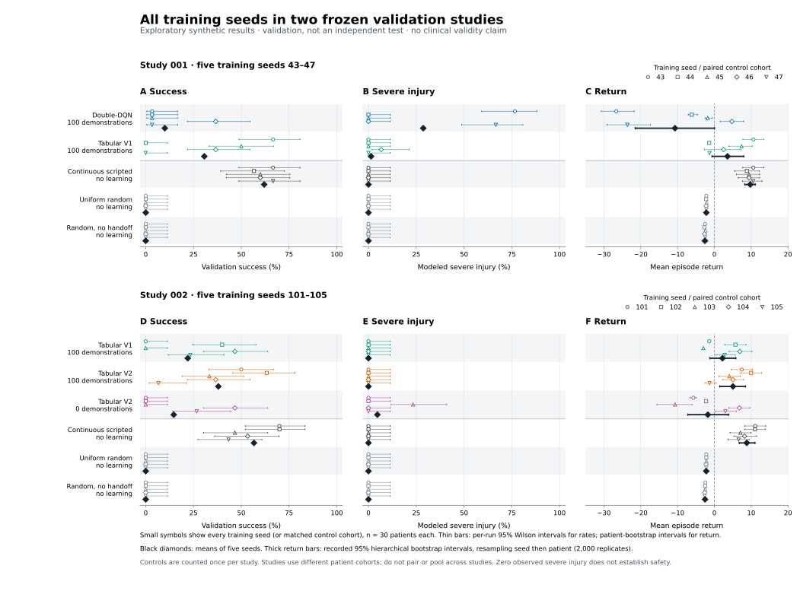
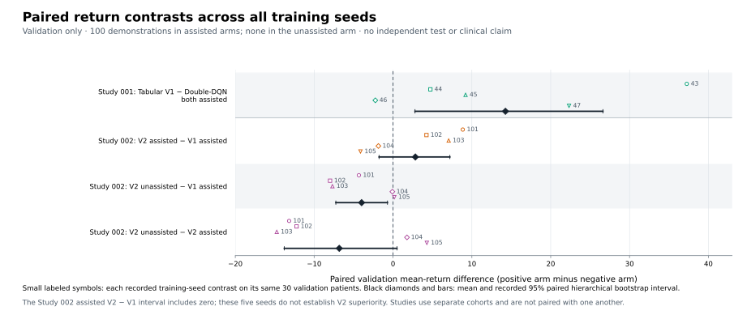

# All-seed validation figures

These figures summarize the frozen [study 001](rl-study-001.md) and [study 002](rl-study-002.md) records. They show every trained run, including harmful and zero-success runs. They do not use the validation-selected reference as a substitute for typical learning performance. No simulator, training, or reserved final evaluation was executed to generate them.



**Figure 1. All training seeds.** Each small symbol represents one training seed's 30-patient validation aggregate, or the same matched 30-patient cohort for an untrained control. Study 001 includes five seeds for each of two demonstration-assisted learners. Study 002 includes five fresh seeds for assisted V1, assisted V2, and unassisted V2. Controls are identical across paired arm directories and appear once per study, preventing duplicate patient counts. Both studies have 150 unique validation patients; they use different cohorts and must not be paired or pooled as one experiment.

Thin bars are stored per-run 95% Wilson intervals for binary outcomes and patient-bootstrap intervals for mean return. Black diamonds show means across all five seeds. Thick return bars show the recorded 95% hierarchical bootstrap intervals: 2,000 replicates resampling training seeds, then patients within the selected seed. No between-seed interval is shown for the binary mean diamonds. With only five training seeds, hierarchical intervals are descriptive and may be unstable; they exclude tissue-model uncertainty. A zero-event run with 30 patients still has a severe-injury Wilson upper bound near 11.35%.

Every learner used 3,000 online episodes. Assisted arms additionally received 100 quantized scripted demonstration trajectories, return initialization or imitation assistance as documented, and demonstration replay. The unassisted arm received none. Equal online episode budgets do not mean equal total observed experience or assistance. The continuous scripted comparator also has a less restricted action representation than the learners' 28 discrete controls. Random policies' low injury frequently accompanies failure to engage tissue or handoff, rather than successful control.

[PNG version](assets/rl-validation-all-seeds.png) · [SVG version](assets/rl-validation-all-seeds.svg)



**Figure 2. Paired return contrasts.** Small labeled symbols show each training seed's difference in validation mean return, pairing the same 30 patients between arms. Black diamonds and bars show the recorded across-seed estimate and paired hierarchical 95% bootstrap interval. Studies remain separate experiments. The intervals are descriptive and unadjusted for multiple comparisons.

Study 002's assisted V2 minus assisted V1 estimate is 2.83 return units, with interval −1.77 to 7.21. These five seeds do not establish V2 superiority. The lower observed unassisted mean also cannot be interpreted as evidence that demonstration assistance alone guarantees useful control: individual assisted runs still fail, and harm and success must be inspected alongside reward. Both figures describe synthetic validation; they establish neither independent-test generalization nor clinical performance.

[PNG version](assets/rl-validation-paired-contrasts.png) · [SVG version](assets/rl-validation-paired-contrasts.svg)

## Reproduce

Use a Python environment containing Matplotlib and NumPy; they are figure tooling, not new application runtime requirements.

```bash
python scripts/plot_frozen_studies.py
```

The script reads the two tracked summaries and complete study ZIP archives. It verifies archive checksums, each raw result's manifest hash, all five seeds per arm, 3,000 recorded training episodes per run, 30 paired validation patients per run, raw-versus-summary metrics, across-seed means, and identical repeated controls before plotting. It never imports the simulator or reads any final-evaluation outputs.

The [provenance JSON](assets/rl-validation-figures-provenance.json) records input and output SHA-256 values, protocol hashes, exact training seeds, renderer versions, and the plotting script hash. SVG text remains editable, and PNG exports use 240 dpi. Regenerating with the same inputs, script, and rendering environment produces identical output bytes.
