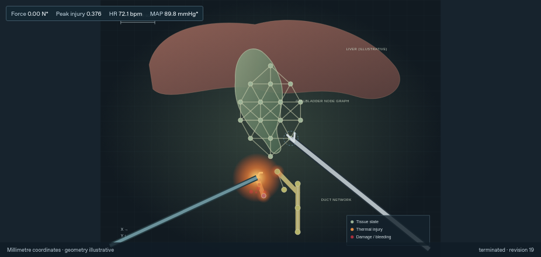

# Retraction Lab 0.2.0 release verification

The self-contained Windows application was built from commit
`e62f26c44d964a360e057338ad8ce7c6a4e039b1`. Later commit `d36eaf7` changes only
browser-test preparation; it does not change the application, models or installer.

[Download the native Windows Setup artifact](https://github.com/returnedlegend/Medical-AI/actions/runs/42085408337/artifacts/13443587116).
GitHub sign-in is required. Extract the artifact ZIP and run
`RetractionLab-0.2.0-windows-x64-Setup.exe`. The ZIP also contains the installer
checksum and build manifest. Python, Node and an external browser are not needed.
The artifact ZIP digest is separate from the Setup executable's checksum.

## Verified scopes

| Check | Recorded result | Evidence |
| --- | --- | --- |
| Genuine native Windows build, Qt window, models and fresh installation/uninstallation | All three workflow jobs passed | [Windows run](https://github.com/returnedlegend/Medical-AI/actions/runs/42085408337) |
| Cohort, procedure and accessibility browser suites; backend and production build | All passed after installed-browser readiness verification | [CI run](https://github.com/returnedlegend/Medical-AI/actions/runs/42088113747), [public check-step receipt](e62f26c/retraction-ci-d36-public-proof.json) |
| Local Windows-Python backup under Wine | All 3,437 installed payload files matched; all four study databases and unrelated files survived uninstall | [Installer receipt](e62f26c/retraction-final-installer-e62f26c.json) |
| Standalone Linux Qt application | Actual interface controls, offline Help, exports, model checks and durable replay passed | [Native GUI receipt](e62f26c/retraction-linux-final-smoke-e62f26c.json), [model receipt](e62f26c/retraction-linux-final-diagnose-e62f26c.json) |
| Source-hosted native Qt paused-injury test | 1,200 seconds; exact state, revision, SVG and rendered pixels unchanged; zero JavaScript console events | [Timed receipt](e62f26c/retraction-native-final-idle-e62f26c.json) |

The local Windows backup uses CPython 3.12.15 under Wine. The primary Windows CI
artifact uses CPython 3.12.10 on a genuine Windows runner, so their binary
checksums differ. Wine checks do not claim graphical Windows success. Native
Windows GUI/install proof comes from the linked Windows workflow. The long
pause test uses source-hosted Qt on Linux with the production interface; it is
not relabeled as a Windows or packaged-application soak.

During the timed check, mean host-plus-child CPU was 1.91% of one core, including
1 Hz monitoring. Aggregate RSS fell by 20.93 MiB. Sum-of-process RSS can count
shared pages more than once; these are engineering observations on this host,
not performance guarantees for every computer.

## Recorded body-response example

The pause test used the controlled **arterial-thermal-contact protocol**,
development seed 2. Nineteen ordinary tool-action transitions produced modeled
injury 0.376 and blood loss 3.649 model mL, then a severe-injury terminal state.
It is a scripted intervention, not a learned policy or a new training run.

The [complete synthetic episode](e62f26c/retraction-native-final-idle-e62f26c-episode.json)
retains actual actions, state changes and rewards. Compare the
[baseline frame](e62f26c/retraction-native-final-idle-e62f26c-baseline.png) and
[final frame](e62f26c/retraction-native-final-idle-e62f26c-final.png): their bytes
are identical after twenty minutes. The [tool/body equations](../docs/tissue-response.md)
explain the injury and feedback mechanisms.

## Provenance and limits

[Release index](e62f26c/release-index.json) records the primary artifact, local
backup checksums and runtime differences. Local backup paths refer to the
original `artifacts/desktop/` workspace; those binaries are not committed here.
[Scope details](e62f26c/validation-scope.json) distinguish every test target.
[Evidence manifest](e62f26c/MANIFEST-SHA256.json) records source and published
file hashes; text newlines are normalized to LF without changing metrics. No
private session headers, credentials or raw logs are published.

The application is an unsigned research MVP with unvalidated tissue mechanics
and toy physiology. These software checks do not establish clinical safety.
The [final fixed-policy assessment](../docs/rl-final-001.md) preserves all
1,920 synthetic rollouts and does not select a replacement policy.
